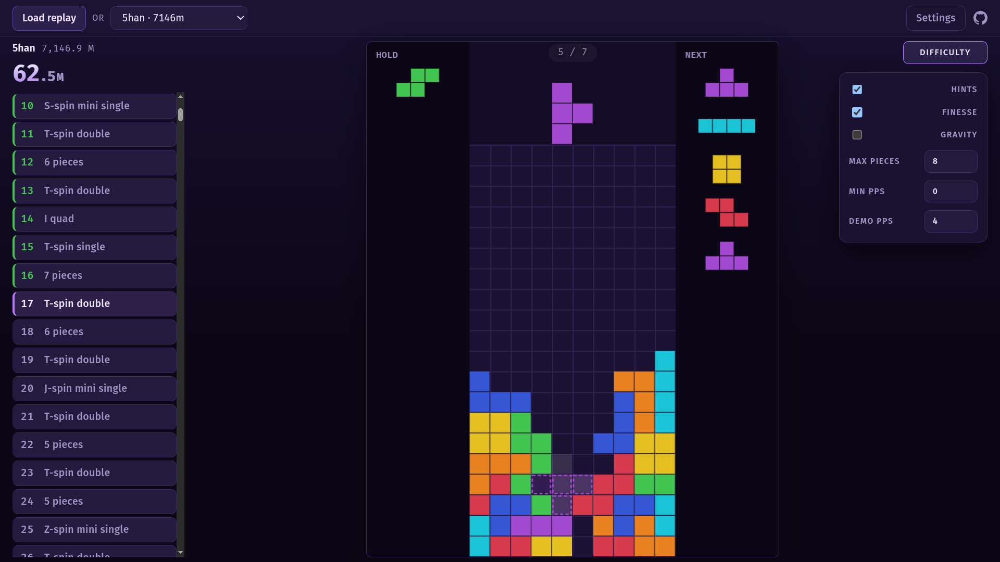

# Tetracer

A [tetr.io](https://tetr.io) trainer that takes any replay and lets you
reproduce it a few pieces at a time. It lets you train T-spins, all-spin,
downstacking, finesse and PPS. Supports all kinds of replays: Quick Play
Zenith Tower (including modded runs), Tetra League, 40 lines and Blitz.

The only dependency is the [Triangle.js](https://triangle.haelp.dev) engine.

Not affiliated with TETR.IO or its developers.

## How it works

[RECONSTRUCTION.md](RECONSTRUCTION.md) — what a replay gives up, what the
capture adds, and how much of a run comes back.
[ZENITH.md](ZENITH.md) — the Zenith findings in full.
